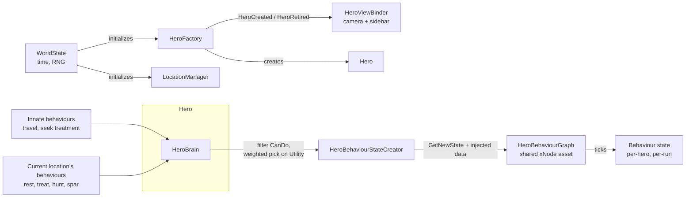

# Automatic Heroes

An idle simulation where heroes live their own lives. They rest, travel, train, hunt monsters and get their wounds treated, and you watch it unfold through an action feed. There's no player input. All the interesting decisions are made by the heroes' AI.

I built this about two years ago as a scrappy prototype for exploring utility AI and [xNode](https://github.com/Siccity/xNode). Recently I came back to it as a code sample. I fixed the bugs, refactored away from some of my old habits, and extended it the way I'd build things today. The older history is exploratory and messy. Everything from `e73b009` onwards is the cleanup and extension pass, in small commits that are meant to be reviewed.

## Running it

1. Open the project in **Unity 2022.3.62f3**.
2. Open `Assets/Scenes/SampleScene.unity` and press Play.

The `Tester` object spawns one hero per `HeroCore` at a random location. World time runs at 900× real time, so 1 real second is 15 world minutes. You can change that on `WorldState` → Time. The sidebar shows each hero's stats and current behaviour, and the feed at the bottom shows level-ups, injuries, monster kills and so on.

## Where to look

If you only have a few minutes:

| What | Where |
|---|---|
| How a hero chooses what to do | [`HeroBrain.cs`](Assets/_Game/_Scripts/HeroBrain.cs), [`HeroBehaviourStateCreator.cs`](Assets/_Game/_Scripts/HeroBehaviourStateCreator.cs) |
| Goal-driven travel (one class per reason to travel) | [`HeroTravelStateCreator.cs`](Assets/_Game/_Scripts/HeroTravelStateCreator.cs), [`DestinationTravelStateCreator.cs`](Assets/_Game/_Scripts/DestinationTravelStateCreator.cs), [`SeekTreatmentStateCreator.cs`](Assets/_Game/_Scripts/SeekTreatmentStateCreator.cs) |
| Pathfinding (A* and Dijkstra in one search) | [`Locations/LocationAStar.cs`](Assets/_Game/_Scripts/Locations/LocationAStar.cs) |
| How a graph node keeps per-hero state | [`AI States/General/HeroBehaviourNode_TreatWounds.cs`](Assets/_Game/_Scripts/AI%20States/General/HeroBehaviourNode_TreatWounds.cs) |
| Data-driven feed messages | [`HeroBehaviourNode_PostToFeed.cs`](Assets/_Game/_Scripts/AI%20States/General/HeroBehaviourNode_PostToFeed.cs), [`AI States/Data Sources/`](Assets/_Game/_Scripts/AI%20States/Data%20Sources/) |
| Composition root and spawning | [`WorldState.cs`](Assets/_Game/_Scripts/WorldState.cs), [`HeroFactory.cs`](Assets/_Game/_Scripts/HeroFactory.cs), [`UI/HeroViewBinder.cs`](Assets/_Game/_Scripts/UI/HeroViewBinder.cs) |
| Behaviour graphs (open them in the xNode editor) | `Assets/_Game/Behaviour Graphs/` |

## Architecture



### Behaviour selection: utility AI

A hero's `HeroBrain` collects the behaviours it can choose from. Some are **innate**: travel, and seeking treatment. The others come from **the location the hero is standing in**: an inn offers rest, a clinic offers treatment, the Howling Planes offer monster hunting. Each one is an `IHeroBehaviourStateCreator` with `CanDo` and `Utility`. The brain drops the ones it can't do and picks from the rest by weighted random on utility. If nothing qualifies, it falls back to waiting.

The brain doesn't know what any behaviour *is*. Adding a behaviour means adding a creator to a location or to the hero prefab. The brain's code doesn't change.

### Behaviour execution: graphs

Each creator points at a `HeroBehaviourGraph`, an xNode graph saved as an asset. The graph describes *how* a behaviour plays out: travel, then rest for a random time, then post to the feed, and so on.

The graph and its nodes are **shared by every hero**, so nodes keep no per-run data in their fields. When a node is entered, it returns its own `State` object, and the graph's `StateManager` tracks one behaviour state per running hero. That lets a dozen heroes run the same Rest graph at the same time without stepping on each other.

Creators pass per-run parameters into the graph as typed `Identity` keys. For example, a clinic and a hospital share one treatment graph but inject different treatment rates.

Monster fights are a nested graph (`MonsterCombatGraph`). It runs inside a hero behaviour node, and its result chooses that node's exit port.

### Travel and pathfinding

Locations advertise what they offer through tags on their behaviour graphs (`ILocation.OffersBehaviour(Tag)`). A hero that needs treatment asks the `LocationManager` for the nearest location *by road* that offers treatment. That's a Dijkstra search, and it shares one implementation with A* (the heuristic is zero instead of straight-line distance). The hero then takes **one hop** along that path. It re-plans when it arrives, so the brain stays memoryless and the hero can change its mind if something more urgent comes up on the way.

Travel is a small class hierarchy. Each subclass is one *reason* to travel:

```
HeroTravelStateCreator (abstract)
├── RandomTravelStateCreator          wander to a neighbouring location
└── DestinationTravelStateCreator (abstract): A* to a destination
    └── SeekTreatmentStateCreator     nearest location that treats wounds
```

### Simulation time

Simulation code doesn't use `Update`. `WorldTime` scales `Time.deltaTime` into world seconds and ticks its registered `IListener`s (behaviour graphs and heroes). Gameplay randomness goes through `WorldState.Rng`.

### Wiring

`WorldState` is the composition root. It initializes `LocationManager` and `HeroFactory`, and every hero receives the `WorldState` in `Hero.Initialize` rather than reaching for a singleton. The views aren't referenced by the game model: `HeroViewBinder` listens to `HeroFactory.HeroCreated`/`HeroRetired` and adds heroes to the camera group and the sidebar.

## Recent work

- **Bug fixes:** NaN in the cause favour maths, attacks resolving out of order within long ticks, an inverted time comparison, a broken player build, pooled-list leaks, event subscription leaks. The commit messages start with *Fix*.
- **Composition over singletons:** `HeroFactory` and `LocationManager` moved from statics and `FindObjectsByType` to scene components initialized by `WorldState`. Views are bound through events.
- **Clinics and hospitals:** injured heroes look for the nearest treatment by road and pay a visit. This brought back the dead A* code, which was fixed and reworked into a single search.
- **Monsters at locations:** monster banks, a monster-only lair, and the hunt behaviour.
- **Data-driven feed messages:** `PostToFeed` takes an array of `BehaviourDataSource` ScriptableObjects that fill the `{n}` slots of its format string. New kinds of message data don't require editing the node.

## What I'd do differently today

These were deliberate decisions to leave alone. The goal of this pass was to clean up and extend, not to rewrite.

- **Tests and assembly definitions.** Everything is in `Assembly-CSharp`, and nothing tests the game code. Pure logic such as `LocationAStar`, `CauseFavourTracker` and the combat odds is easy to test, and two of the bugs I fixed (the favour NaN and the draw rule) are exactly what tests catch. If I continued this project, splitting into asmdefs and adding EditMode tests would come first.
- **Fixed-step simulation.** World time is variable-step, so combat outcomes depend on frame rate. I'd use a fixed tick, decoupled from rendering, with a seeded RNG, so runs are reproducible and testable.
- **Hand-written port switches.** Every graph node maps its ports in a `GetFlowPort` switch, and a port missing from it is silently never wired. I'd cache ports by reflection once per type, or generate the switch, and add an editor validator.
- **Two graph runtimes.** Hero behaviour graphs keep per-node state, but monster combat graphs share one mutable blackboard. I'd unify them into one generic flow runtime with per-node state.
- **Remaining statics.** `ActionFeed` is a static event hub, and `WorldDate`/`TimeOfDayPreference` still reach for `WorldState.Instance`. I'd finish the injection that `Hero` now uses.
- **Runtime state on ScriptableObjects.** `HeroCore` caches the hero's weapon instance on the asset, which only works because each core is one hero. Definitions should stay immutable, and runtime instances should hold the state.
- **Per-property boilerplate.** About 50 observable properties are each a field, an event and a setter written by hand. I'd use an `Observable<T>` wrapper or source generation.

## Next up

**Quests.** A town posts "kill N monsters at X". A hero accepts it, travels there, hunts, comes back and turns it in for favour with their cause. The plan needs no new systems:

- accepting and turning in are behaviours the town's quest board offers;
- going to the quest and coming back is one more `DestinationTravelStateCreator` subclass;
- kills are counted from a `Hero.MonsterDefeated` event.

The brain still wouldn't know quests exist.

## Project layout

- `Assets/_Game/_Scripts/`: game code.
- `Assets/_Game/Behaviour Graphs/`: hero behaviour and monster combat graphs.
- `Assets/_Game/Scriptable Objects/`: data: hero cores, monsters, skills, causes, weapons.
- `Assets/SegoLib/`: my general-purpose utility library (MVVM UI, weighted random, `Identity`, lifecycle interfaces).
- Third party: xNode, NaughtyAttributes, DOTween, Json.NET, Cinemachine, TextMeshPro.

## On AI

I paired with Claude Code on the recent pass. I wrote most of the fixes and refactors myself, which was also how I got reacquainted with my own two-year-old code. Claude helped review the project and drafted parts of the extensions. The design decisions were mine, I reviewed every line, and I stand behind every change in the history.
